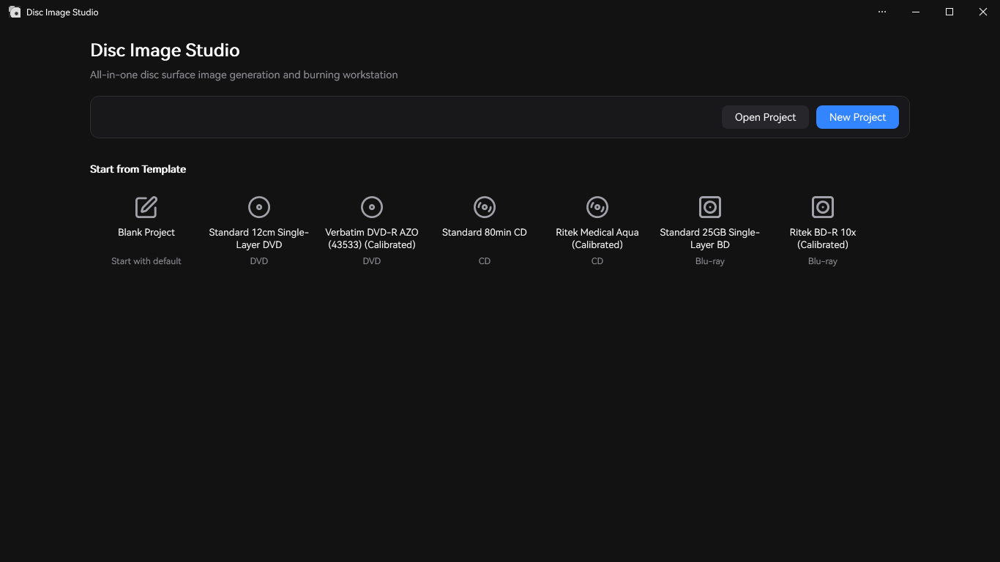
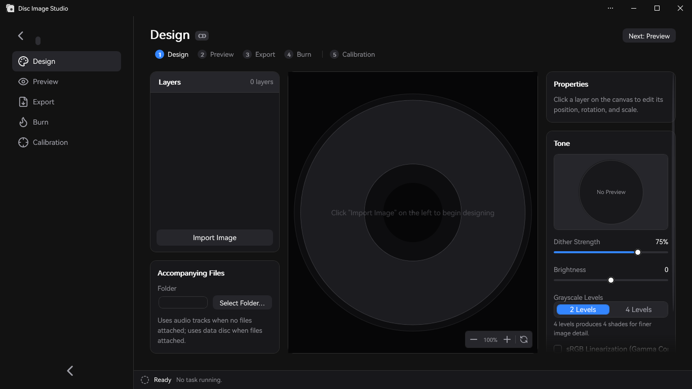
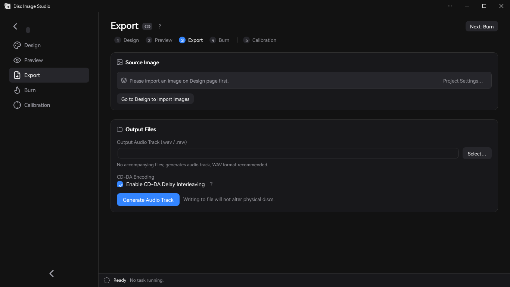

<div align="center">


<h2>All-in-one Disc Surface Visible Image Generation & Burning Workstation</h2>

Disc Image Studio is a Windows desktop application that lets you etch human-visible images and patterns onto **any** DVD, CD, or Blu-ray disc using **standard** optical burner drives.


</div>

---

## Result Preview


---

## Overview

Disc Image Studio converts images into data that conforms to the physical layer constraints of CD, DVD, and single-layer BD-R optical media. When written to a blank disc, the variations in pit/land density create clear, visible patterns directly on the recording surface.

## Interface Preview







---

## Quick Start

Download the latest release executable from [GitHub Releases](https://github.com/JiaFeiMiao-K-Cat/DiscImageStudio/releases). The release `.exe` is self-contained and includes the .NET runtime—just extract and run directly.

### 1. Create a Project

Select CD, DVD, or Blu-ray on the Home page, specify an output file location, and create your project.

### 2. Design the Disc Surface

Import images on the Design page, adjust layout with layers, and customize dither strength, sRGB gamma linearization, brightness, and grayscale levels in the right-hand **Tone** panel.

### 3. Preview & Export

Inspect the visual projection on the Preview page, generate ISO / RAW / WAV+CUE images on the Export page, or stream-burn directly to a blank disc.

> [!NOTE]
> Direct streaming burn is an experimental feature. Please only use disposable test media.

---

## Features

### Optical Disc Data Generation

- **CD Support**: Supports standard CD-R/RW media. Export formatted WAV audio tracks with companion CUE sheets compatible with burning tools like `cdrecord` and ImgBurn, or export raw CD-DA tracks. See [CD Audio Compatibility Guide](docs/CD_AUDIO_COMPATIBILITY.md).
- **DVD Support**: Supports standard DVD-R/RW and DVD+R/RW media. Exports complete ISO images.
- **Blu-ray Support**: Supports single-layer 25 GB BD-R discs with pure image data or hybrid UDF 2.01 filesystems. See [ADDING_BLURAY.md](docs/ADDING_BLURAY.md).
- **Accompanying Files**: Place data files alongside the drawing in the inner or outer ring area on CD, DVD, and Blu-ray discs. File placement settings are saved with the project.
- **File Zone Preview**: Projected and readback simulations visually highlight the data file area (including filesystem structures) in yellow.
- **Physical Grayscale Schemes**: CD and DVD use binary black/white modulation (CD uses `0x0D / 0xAA`, DVD scrambler domain uses `0xA5 / 0x92`). See [PHYSICAL_MODEL_AUDIT.md](docs/PHYSICAL_MODEL_AUDIT.md).
- **Standalone Dithering Tool**: Includes `FourLevelDither.exe` for converting images into binary `0/255` PNGs with serpentine Floyd–Steinberg error diffusion and optional sRGB gamma linearization. See [Dither Tool Guide](tools/FourLevelDither/README.md).
- **Built-in Presets**: Ships with pre-calibrated geometric presets for popular disc brands across CD, DVD, and BD. Custom presets can be saved and shared. See [Disc Presets Guide](docs/DISC_PRESETS.md).

### Assisted Calibration

Disc Image Studio includes a computer-vision assisted calibration workflow. By analyzing photographs of a test-pattern disc, the algorithm refines physical track geometry from an initial $10^{-6}$ precision down to $10^{-14}$. This resolves radial curve distortion caused by non-linear track pitch on DVD media:

| Before Calibration (Constant Pitch) | After Calibration (Cubic Pitch) |
| --- | --- |
|  |  |
| Radial lines appear visibly curved | Radial lines remain straight |

For the complete calibration workflow, see [Calibration Guide](docs/CALIBRATION.md).

### Burning Options

- **Image File Export**: Generate complete ISO / RAW / WAV+CUE files to burn using your preferred optical software.
- **Direct Streaming Burn (Experimental)**: Stream-generate and write data on-the-fly to CD, DVD, and BD-R without saving large temporary disk images. BD-R uses direct SCSI MMC sequential recording without spare area remapping.
- **Always use blank media!** Rewritable media or discs with existing tracks are rejected to prevent data loss.

### Application Architecture

- **Dual Entry Point**: Running without arguments opens the full WPF GUI; passing arguments enters the unified CLI engine.
- **Modular Design**: CD, DVD, and Blu-ray are unified under `IOpticalDiscModule` with standardized command catalogs and task contracts. See [Architecture Guide](docs/ARCHITECTURE.md).

---

## System Requirements

- **OS**: Windows 10 (version 2004 / build 19041 or later) or Windows 11.
- **Runtime**: Pre-built Release executables are self-contained and run without installing .NET. Building from source requires the .NET 9 SDK (or .NET 10 SDK).
- **Hardware**: A Windows-compatible CD / DVD / BD optical burner drive and blank recordable media (BD-R requires single-layer blank media supporting sequential recording).

---

## Building from Source

```powershell
# Build entire solution
dotnet build src/DiscImageStudio.App/DiscImageStudio.App.csproj --configuration Release

# Run GUI
dotnet run --project src/DiscImageStudio.App --configuration Release

# Publish self-contained single-file executable
dotnet publish src/DiscImageStudio.App/DiscImageStudio.App.csproj -c Release -r win-x64 --self-contained true -p:PublishSingleFile=true -o publish
```

### Regression Verification

```powershell
dotnet run --project src/DvdImageSolver --configuration Release -- selftest
```

---

## Command-Line Interface (CLI)

Running `DiscImageStudio.exe` with arguments executes automation commands:

| Command | Description |
| --- | --- |
| `solve` | Generate DVD ISO image using rapid texture mapping with optional Floyd–Steinberg dither |
| `encode` | Encode an individual DVD ECC block into NRZI channel bits |
| `calibrate` | Calibration projection: sample DVD source image by nominal geometry and project to disc surface |
| `simulate` | Optical readback simulation of a generated DVD ISO against calibrated geometry |
| `selftest` | Execute deterministic self-tests on the DVD encoding engine |
| `cd-generate` | Generate WAV + CUE / RAW audio track, or CD data ISO when `--data-dir` is provided |
| `cd-preview-warp` | Calibration projection: project CD source image against measured geometry |
| `cd-preview-track`| Render an existing WAV or RAW CD-DA audio track against calibrated geometry (readback simulation) |
| `bd-generate` | Generate complete BD-R ISO with `<iso>.json` sidecar metadata |
| `bd-info` / `bd-probe` / `bd-encode` | Export Blu-ray parameters, raw payload probe tests, or single ECC cluster diagnostics |
| `ui-snapshot` | Render off-screen screenshot of any workspace tab or dialog to a PNG image |

---

## Repository Structure

```text
src/DiscImageStudio.Core/    Media-agnostic module contracts, project/preset models, task engine
src/DiscImageStudio.Imaging/ Image preprocessing and dithering algorithms shared across CD/DVD/BD
src/DiscImageStudio.Burning/ Windows IMAPI2 device discovery, stream buffering, and MMC burning layer
src/DiscImageStudio.Cd/      CD-DA generation engine, interleaving algorithms, and CD module
src/DiscImageStudio.Dvd/     DVD engine adapter and ISO orchestration
src/DiscImageStudio.BluRay/  BD-R geometry, 17PP/ECC modulation, 3T/6T mapping, streaming generator
src/DiscImageStudio.Iso/     UDF 2.01 / ISO 9660 filesystem image writer
src/DiscImageStudio.App/     WPF desktop GUI and unified CLI runner
src/DvdImageSolver/          Isolated DVD NRZI encoding and constraint solver engine
tools/                       Auxiliary probe tools and standalone FourLevelDither utility
docs/                        Architecture, engine specifications, calibration, and release guides
```

---

## Reference Standards

Disc Image Studio's physical models implement the following international standards:

| Media | Standard & Version | Scope in this Project |
| --- | --- | --- |
| **CD-R** | [ECMA-394 (1st Edition, Dec 2010)](https://ecma-international.org/publications-and-standards/standards/ecma-394/) — *Recordable Compact Disc Systems CD-R Multi-Speed* | CD-R physical media, multi-speed recording, and CD-DA compatibility; generates CD-DA tracks. |
| **DVD-ROM** | [ECMA-267 (3rd Edition, Apr 2001)](https://ecma-international.org/publications-and-standards/standards/ecma-267/) — *120 mm DVD – Read-only disk* | DVD data frames, ECC blocks, EFMPlus modulation, and Appendix G conversion tables. |
| **DVD-R** | [ECMA-359 (1st Edition, Dec 2004)](https://ecma-international.org/publications-and-standards/standards/ecma-359/) — *80 mm and 120 mm DVD Recordable Disk (DVD-R)* | Single-layer DVD-R geometry, sector layouts, error correction, and lead-in/lead-out zones. |
| **BD-R** | [ISO/IEC 30190:2021 (3rd Edition, Jan 2021)](https://www.iso.org/standard/80770.html) — *120 mm Single-Layer (25.0 GB) and Dual-Layer (50.0 GB) BD-R Information Exchange* | Single-layer 25 GB track geometry, sector layout, 17PP modulation, and physical cluster mapping. |

General CD channel encoding also references [ECMA-130 (2nd Edition, 1996)](https://ecma-international.org/publications-and-standards/standards/ecma-130/).

---

## Safety & Media Notice

- Disc Image Studio does not install third-party kernel drivers or background services; burning relies on Windows IMAPI2 and standard SCSI pass-through.
- "Streaming Burn" is an experimental feature. Drive models, firmware revisions, and disc media vary widely. Please only test with media you are willing to discard.
- Visual image contrast depends on your drive optics, disc dye chemistry, write speed, and burner firmware strategies.
- BD-R sequential writing does not utilize spare area remapping; interrupted burns cannot be resumed on the same disc.

---

## Privacy & Security

- Disc Image Studio runs entirely offline. It does not send telemetry, connect to remote servers, or upload data. See [PRIVACY.md](PRIVACY.md).
- To report security issues, please follow the [Security Policy](SECURITY.md) using private vulnerability reporting.

---

## License

This project is licensed under the [GNU General Public License v3.0 or later](LICENSE) (`GPL-3.0-or-later`).
The CD interleaving implementation incorporates modified code from CDImage, distributed under compatible GPL terms. Third-party components and fonts are subject to their respective licenses; see [LICENSE-NOTICE.md](LICENSE-NOTICE.md) and [THIRD-PARTY-NOTICES.txt](THIRD-PARTY-NOTICES.txt).

---

## Acknowledgements

Special thanks to [arduinocelentano's CDImage project](https://github.com/arduinocelentano/cdimage) for demonstrating optical disc surface image generation via CD audio tracks, which served as an important inspiration and foundation for the CD interleaving implementation in this project.
